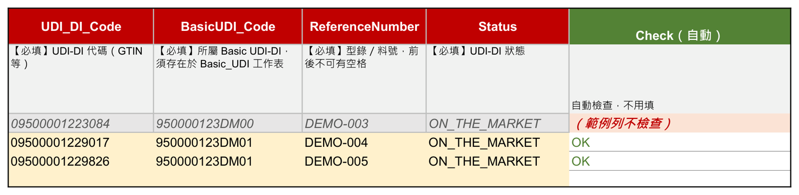
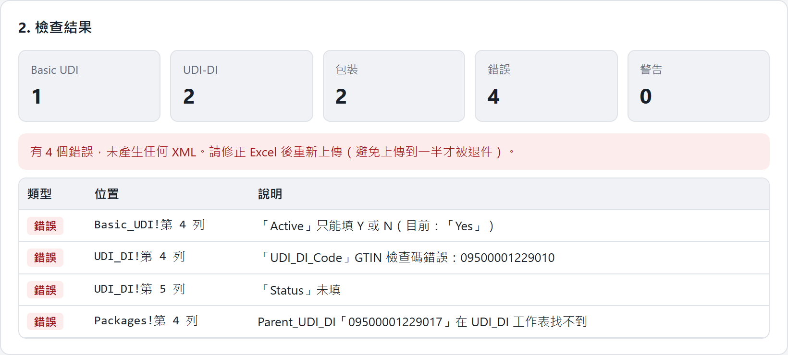
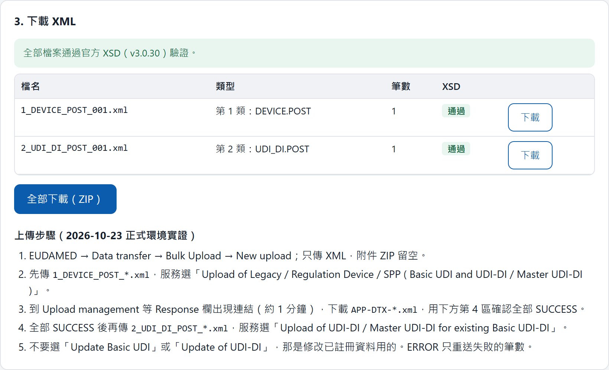
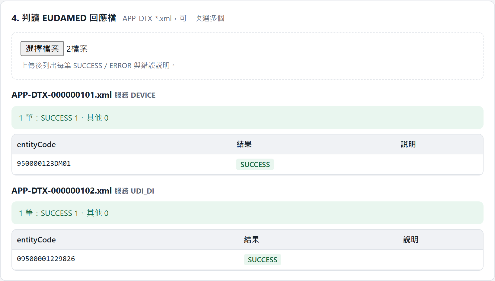

[English version](/blog/eudamed-ai-consultant/)

先講結論：這次我的角色是第三方技術顧問。使用者要在歐盟的醫療器材資料庫 EUDAMED 註冊產品，卡在網站操作不直覺。最後交付的是一條「不容易出錯」的路：使用者填一份照官方規格做的 Excel，丟進一個離線網頁，產出官方接受的檔案再上傳。一路有四道驗證，最後一道是官方自己的回覆。

## 起點：一個看似簡單的問題

使用者問我的第一個問題是：「資料已經上傳了，現在要改，要從哪裡改？」

EUDAMED 是歐盟法規要求的資料庫，醫材廠商要把產品資料登錄上去。網站功能很完整，但對不常用的人很不友善：選單名稱長得很像、說明分散在好幾份 PDF，找不到「更新」的入口。

我沒有直接去網站上點來點去，而是先請 AI 把官方文件讀完。

## 第一步：讓 AI 先讀規格

我請 AI 讀的是官方公開的這幾份：資料欄位定義（data dictionary）、業務規則（business rules）、系統對接手冊，以及 Bulk upload 的說明頁。這些內容分散在好幾份 PDF、Excel 與網頁裡，光是找齊就要花不少時間。

AI 讀完的第一個結論，不是好消息：**多數欄位一旦註冊就不能改**。風險等級、是否無菌、是否含乳膠這類欄位，填錯只能換新代碼重新註冊。

這一句話把問題重新定義了。要解的不是「怎麼改」，而是「怎麼第一次就填對」。

接著 AI 盤點了官方支援的上傳方式：網頁畫面逐筆輸入、Bulk upload（上傳 XML 檔）、系統對系統的 M2M 對接。官方只收 XML，沒有提供 Excel 範本。市面上也有幾家工具在做 Excel 轉 XML，做法跟我們想的一樣。

決定是我做的：用 Bulk upload，自己做範本與轉檔，外部工具留作備案。理由很簡單：資料不用交給第三方，規則也握在自己手上。

## 官方範例裡藏了一個陷阱

官方提供兩樣東西給開發者：XSD（定義 XML 格式的規格檔）和範例 XML。照理說，照著範例寫就對了。

AI 讀手冊附錄時發現，其中一個範例是**故意寫錯的反例**，用來示範「這樣會被退件」。它的寫法看起來很合理，一個主檔下面掛好幾個產品。照抄的話，整批上傳都會失敗。

這種細節，就是先讀完規格的價值。如果一開始就照範例寫程式，要到上傳被退件才會發現。

## 依規格打造 Excel 範本

使用者熟悉的是 Excel，不是 XML。所以第一個交付物是一份範本，欄位完全照官方的資料定義：

- 第 1 列是官方欄名，第 2 列是中文說明，第 3 列是範例
- 必填欄位標紅，選項欄位做成下拉選單，不讓人自由輸入
- 最右邊有一欄自動檢查，每一列填完就顯示 OK 或缺什麼

畫面裡的代碼與品名都是示意資料。

## 轉檔工具：先寫程式，再做成一個網頁

轉檔程式我先用 C# 寫，因為好測試、規則好維護。寫完才發現一個現實問題：使用者的電腦不會為了這件事去裝開發環境。

所以又把它做成一個單一的 HTML 檔。雙擊就能開，所有處理都在瀏覽器裡完成，不連網路，資料不會離開使用者的電腦。官方 XSD 也一起包進去，在瀏覽器裡就能驗證。

兩個版本我用同一批測試資料逐字比對，產出的 XML 完全一樣。

## 四道驗證關卡

這是整個專案的核心。使用者每次上傳，都會經過四道關卡，任何一道沒過，就回到 Excel 修正：

**關卡 1：填寫時。** Excel 的 Check 欄當場告訴你哪一列少填。

**關卡 2：轉檔前。** 網頁把整份 Excel 檢查一遍：必填、Y/N、代碼的檢查碼、重複代碼、包裝層級。只要有一個錯誤，就不產生任何檔案，並且指出是哪個工作表的第幾列。寧可一開始就擋下，也不要上傳到一半才被退件。

**關卡 3：產生檔案後。** 用官方 XSD 驗證每一個 XML，沒通過就不給下載。工具也會自動把資料拆成「新註冊」與「加掛在既有主檔下」兩類檔案，避開前面說的那個範例陷阱。

**關卡 4：官方回覆。** 這一道最容易被忽略。上傳後，官方網站會顯示「已收件」，看起來像成功了，但那只代表收到檔案。約一分鐘後，官方會產出一份回應檔，每一筆資料各自標示 SUCCESS 或 ERROR。網頁工具可以直接讀這份回應檔，列出每筆結果；有 ERROR 的，只重送那幾筆。

我跟使用者約定的完成標準是：**官方回應全部 SUCCESS，而且在官方查詢頁查得到，才算數。**

## 先自己走一遍，再交出去

交付之前，我先用第一批真實資料在正式環境上傳。兩類檔案依序送出，官方回應都是 SUCCESS，查詢頁也查得到。確認整條路走得通，才把範本與網頁交給使用者，並把上傳步驟寫進網頁裡。

截圖裡的代碼、編號都是示意資料，不是真實產品。

## 回頭看顧問這個角色

這個專案我花最多時間的地方，不是寫程式。

**1. 先讀規則，問題會被重新定義。** 使用者問的是「怎麼改」，讀完規格才知道真正要解的是「怎麼第一次就填對」。這一步交給 AI 很適合：它讀得快，而且會把出處標出來，我再挑重點回原文確認。

**2. AI 負責讀和做，判斷留在人手上。** 用哪種上傳方式、要不要自建、什麼叫完成，這些是顧問該做的決定。AI 能把選項整理得很清楚，但不會替你承擔後果。

**3. 驗證要疊好幾層，最後一層交給官方。** 自己的檢查再完整，也只是推測官方會接受。官方的回應檔才是真正的答案，所以流程一定要讀到它才結束。

**4. 交付的是流程，不只是程式。** 使用者不需要懂 XML，也不需要懂 XSD。他們只要會填 Excel、會按按鈕、會看 SUCCESS。把複雜度留在工具裡，是這次最想做到的事。
