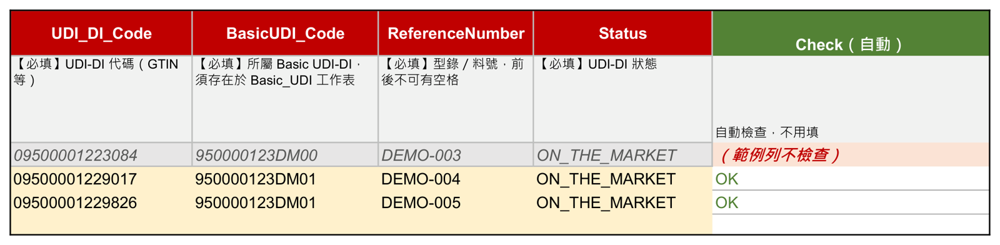
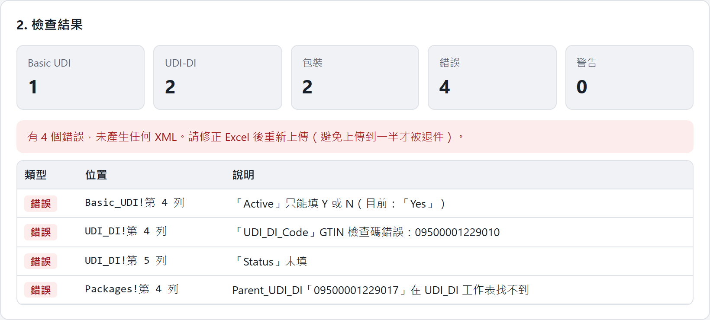
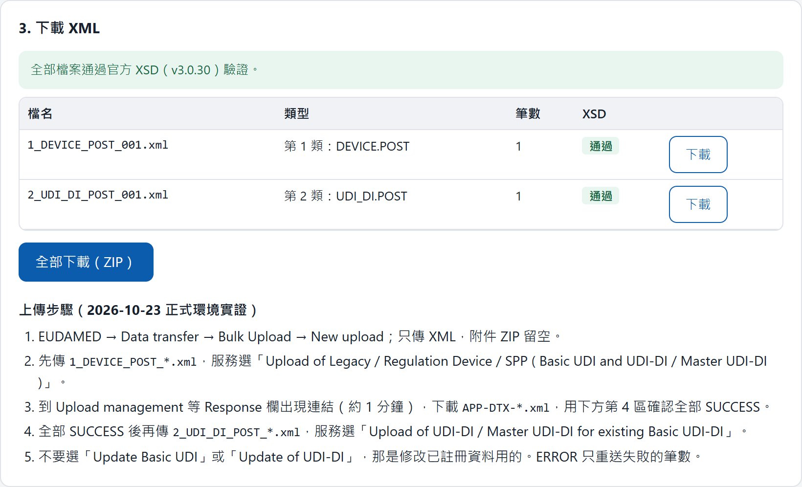
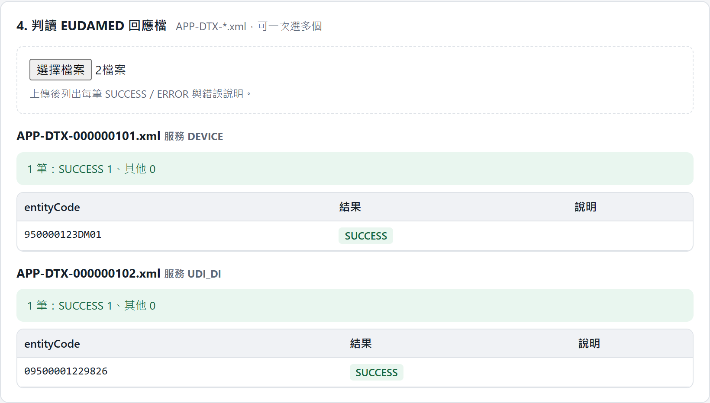

[中文版](/blog/eudamed-ai-consultant-zh/)

Bottom line first: on this project I acted as a third-party technical consultant. The user needed to register products in EUDAMED, the EU's medical device database, and the site was hard to use. What I delivered was a path that's hard to get wrong: fill in an Excel template built from the official spec, drop it into an offline web page, get files the EU system accepts, upload. There are four validation gates along the way, and the last one is the EU system's own reply.

## Where it started: a simple-sounding question

The first thing the user asked was: "We already uploaded the data. Now we need to change it. Where do we do that?"

EUDAMED is required under EU regulation. Device makers register their products there. The site does a lot, but it isn't friendly to occasional users. Menu names look alike, the documentation is spread across several PDFs, and there was no obvious "update" button.

I didn't start clicking around the site. I had AI read the official documentation first.

## Step one: let AI read the spec

I pointed AI at the public documents: the data dictionary, the business rules, the system-to-system (M2M) manual, and the bulk upload help pages. They're spread across PDFs, spreadsheets and web pages, and just gathering them takes a while.

AI's first finding was not good news: **most fields can't be changed once registered.** Risk class, sterile or not, contains latex or not. Get one of those wrong and the only fix is a new code and a fresh registration.

That one sentence reframed the problem. The real question wasn't "how do we edit it." It was "how do we get it right the first time."

Next, AI mapped the supported upload paths: screen entry one item at a time, bulk upload (an XML file), or a machine-to-machine connection. The EU accepts XML only and provides no Excel template. A few commercial tools convert Excel to XML, the same approach we had in mind.

The decision was mine: bulk upload, our own template and converter, with commercial tools as a fallback. The reasoning was simple. The data stays with us, and so do the rules.

## A trap hidden in the official samples

The EU gives developers two things: XSD files (the schema that defines the XML format) and sample XML. You'd expect to be safe copying the samples.

While reading a manual appendix, AI found that one sample is **a deliberate negative case**, there to show what gets rejected. It looks perfectly reasonable: one parent record with several products under it. Copy it and the whole upload fails.

This is why you read the spec before writing code. Start from the samples and you'd only find out when the upload bounced.

## An Excel template built from the spec

The user knows Excel, not XML. So the first deliverable was a template whose columns follow the official data dictionary exactly:

- Row 1 holds the official field names, row 2 a plain-language description, row 3 an example
- Required fields are red; fields with fixed options are dropdowns, so nobody types free text
- A Check column on the right shows OK, or what's missing, for every row

The codes and product names in the screenshot are sample data. The descriptions in row 2 are in Chinese for the user.

## The converter: code first, then a web page

I wrote the converter in C# first, because it's easy to test and the rules are easy to maintain. Then a practical problem showed up: the user's computer wasn't going to get a developer toolchain installed just for this.

So I turned it into a single HTML file. Double-click to open. Everything runs in the browser, offline, and the data never leaves the user's machine. The official XSD is bundled in, so validation happens in the browser too.

I ran both versions against the same test data and compared the output byte for byte. The XML was identical.

## Four validation gates

This is the heart of the project. Every upload passes through four gates. Fail any of them and you go back to Excel:

**Gate 1: while typing.** The Check column in Excel tells you right away which row is missing something.

**Gate 2: before conversion.** The web page checks the whole workbook: required fields, Y/N values, code check digits, duplicate codes, packaging levels. One error and no files are produced, and it tells you the sheet and row. Better to stop at the start than to get rejected halfway through an upload.

**Gate 3: after generating files.** Every XML is validated against the official XSD, and nothing can be downloaded until it passes. The tool also splits the data into "new registration" and "add to an existing parent" files, which sidesteps the sample trap above.

**Gate 4: the EU's reply.** This is the one people miss. After uploading, the site says the file was received. That looks like success, but it only means the file arrived. About a minute later the EU system produces a response file with SUCCESS or ERROR for every item. The web tool reads that file and lists each result. Only the items marked ERROR get resent.

The definition of done I agreed with the user: **every item comes back SUCCESS, and it shows up in the EU's public lookup.**

## Walk the path before handing it over

Before handing anything over, I uploaded the first batch of real data to the live system myself. Both file types went through in order, the EU replied SUCCESS for each, and the records showed up in the lookup. Only after the whole path worked end to end did the template and web page go to the user, with the upload steps written into the page.

All codes and IDs in the screenshots are sample data, not real products.

## Looking back at the consultant role

The part of this project that took the most time wasn't coding.

**1. Read the rules first, and the problem changes.** The user asked "how do we edit it." The spec said the real job was "get it right the first time." AI is a good fit for this step: it reads fast and cites where each rule comes from, and I check the important ones against the original.

**2. AI reads and builds. People make the calls.** Which upload path, build or buy, what counts as done: those are a consultant's decisions. AI lays out the options clearly, but it doesn't own the outcome.

**3. Stack the validation, and let the last layer be the authority's.** However thorough your own checks, they're still a prediction of what the EU will accept. The response file is the real answer, so the process isn't finished until you've read it.

**4. Deliver a process, not just a program.** The user doesn't need to understand XML or XSD. They need to fill in Excel, click a button and read SUCCESS. Keeping the complexity inside the tool was the main goal.
